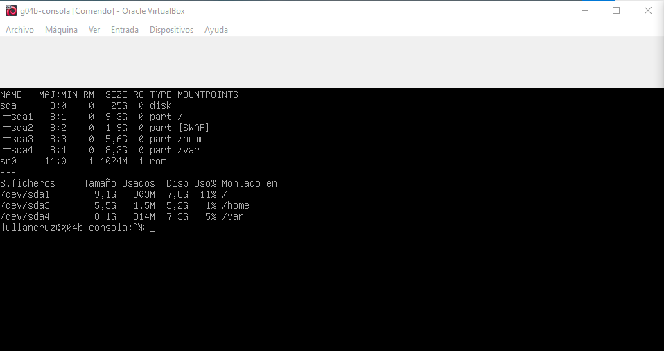
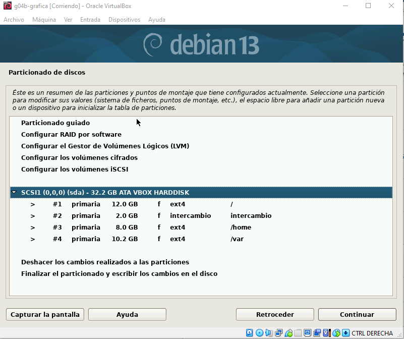
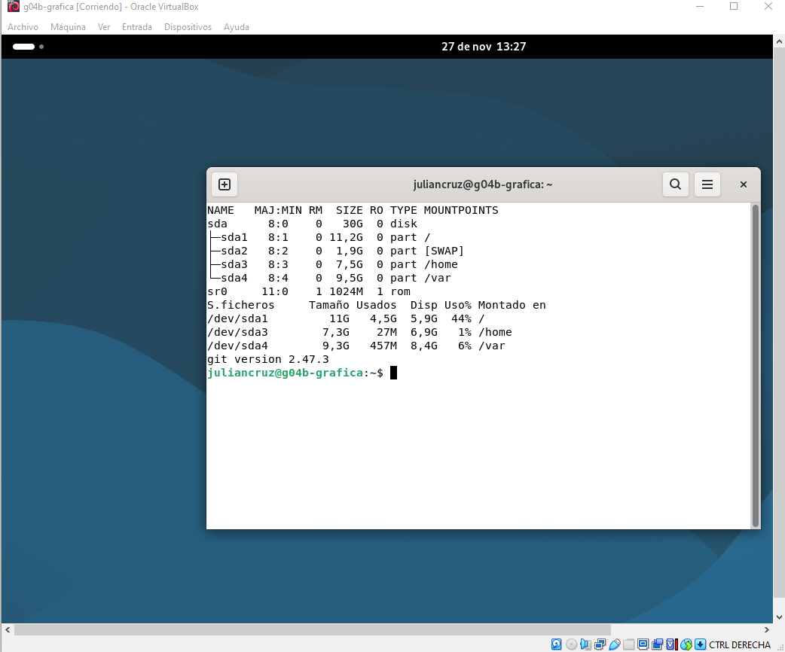

# Evidencias de Infraestructura y Red — Sprint 1 (Grupo g04b)

## 1. Máquina Virtual `g04b-consola` (192.168.56.10)
* **Particionamiento y montaje (`lsblk`, `df -h`, `/etc/fstab`):**
  

* **Instalación de herramientas base (`make`, `rsync`, `curl`, `git`, `wget`):**
  

## 2. Máquina Virtual `g04b-grafica` (192.168.56.20)
* **Particionamiento del disco de 30 GB:**
  

* **Entorno gráfico GNOME, particiones activas y herramientas:**
  

## 3. Conectividad en Red Interna (`192.168.56.0/24`) y Acceso SSH
* **Prueba `ping` y sesión remota SSH desde `g04b-grafica` hacia `g04b-consola`:**
  
