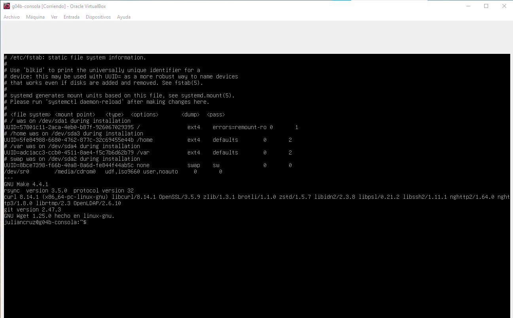
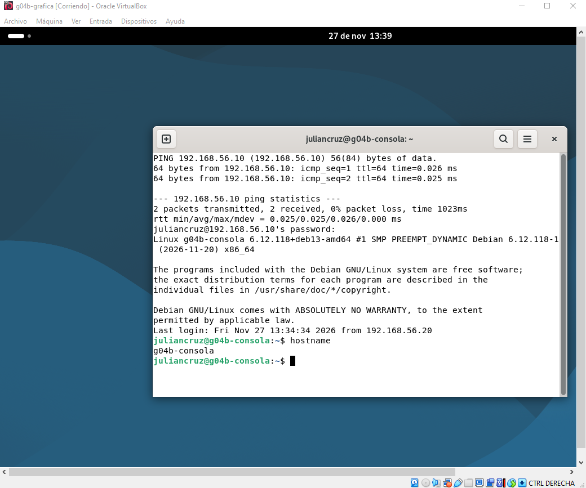

# Sprint 1: Aprovisionamiento de Infraestructura y Red — Grupo g04b

* **Integrantes:** Julian Andrés Cruz Garcia y Laura Caicedo
* **Video de sustentación (3 minutos):** [Ver video del Sprint 1](https://www.youtube.com/watch?v=tl9oUJqlMDw)

---

## Punto 1: Máquina Virtual `g04b-consola` — Particionamiento y Montaje
Verificación de la estructura de discos, particiones activas, puntos de montaje y configuración persistente en `/etc/fstab` (`192.168.56.10`):

    lsblk
    df -h
    cat /etc/fstab

---

## Punto 2: Máquina Virtual `g04b-consola` — Instalación de Herramientas Base
Actualización de repositorios, instalación de paquetes requeridos (`make`, `rsync`, `curl`, `git`, `wget`, `openssh-server`), asignación de permisos administrativos (`sudo`) y verificación de versiones:

    apt update
    apt install -y make rsync curl git wget openssh-server sudo
    usermod -aG sudo juliancruz
    make --version | head -n 1
    rsync --version | head -n 1
    curl --version | head -n 1
    git --version
    wget --version | head -n 1

---

## Punto 3: Máquina Virtual `g04b-grafica` — Particionamiento de Disco (30 GB)
Inspección de la tabla de particiones del disco virtual de 30 GB y uso del sistema de archivos en `g04b-grafica`:

    lsblk -f
    df -h

---

## Punto 4: Máquina Virtual `g04b-grafica` — Entorno Gráfico GNOME y Herramientas
Instalación de herramientas de desarrollo y verificación del entorno gráfico GNOME junto con las utilidades instaladas en `g04b-grafica`:

    sudo apt update
    sudo apt install -y make rsync curl git wget openssh-server
    make --version | head -n 1
    rsync --version | head -n 1
    curl --version | head -n 1
    git --version
    wget --version | head -n 1

---

## Punto 5: Configuración de Red Interna (`192.168.56.0/24`) y Acceso Remoto SSH
Configuración de direcciones IP estáticas en la interfaz de red interna (`enp0s8`) de ambas máquinas virtuales y validación de conectividad mediante `ping` y conexión remota `ssh`:

* **En `g04b-consola` (`/etc/network/interfaces`):**

      sudo nano /etc/network/interfaces
      # auto enp0s8
      # iface enp0s8 inet static
      #     address 192.168.56.10/24
      sudo ifup enp0s8
      ip a show enp0s8

* **En `g04b-grafica` (`nmcli`):**

      sudo nmcli connection modify "Conexión cableada 2" ipv4.addresses 192.168.56.20/24 ipv4.method manual
      sudo nmcli connection up "Conexión cableada 2"
      ip a show enp0s8

* **Prueba de conectividad y sesión SSH desde `g04b-grafica` hacia `g04b-consola`:**

      ping -c 4 192.168.56.10
      ssh juliancruz@192.168.56.10

